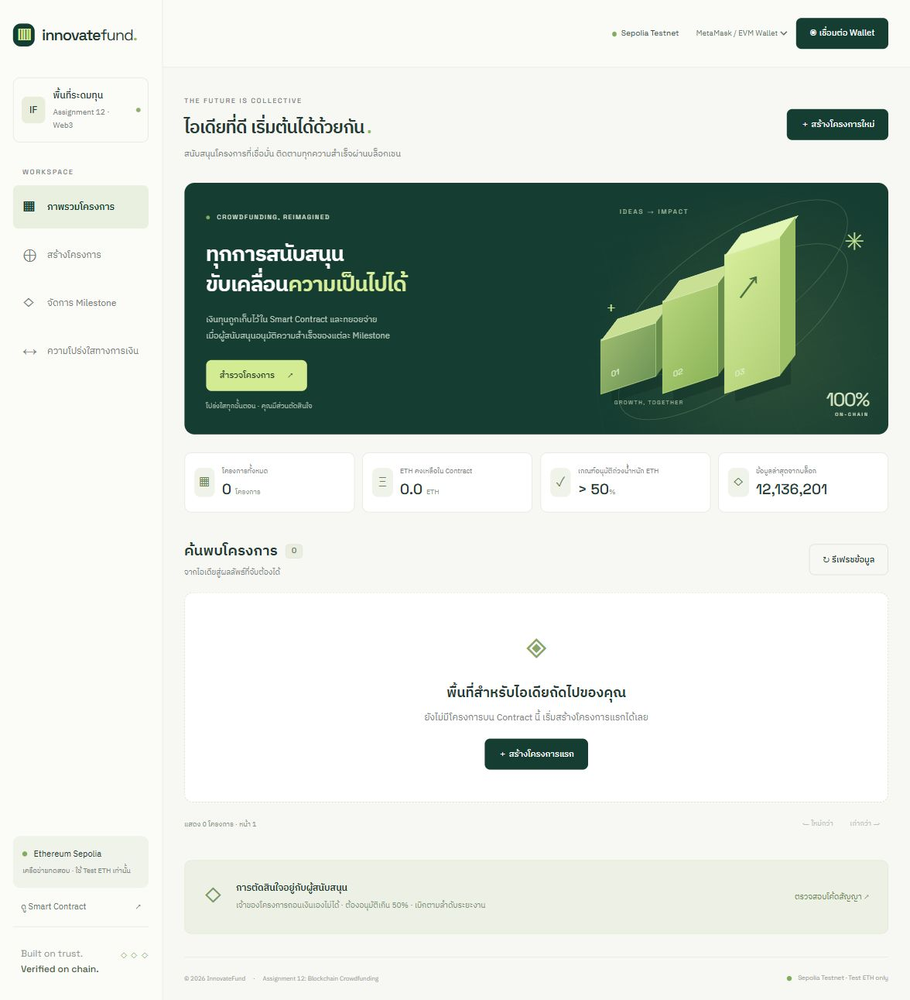

# InnovateFund · Assignment 12

Frontend สำหรับ Blockchain Crowdfunding & Milestone Fund Management บน Ethereum Sepolia ใช้ HTML, CSS, TypeScript (แปลงเป็น JavaScript ด้วย Vite) และ Ethers.js v6 รองรับทั้งมือถือและ desktop

**Contract:** [`0x7AdC7237D1E4aC47C8E315e10711428c431bAF6B`](https://sepolia.etherscan.io/address/0x7AdC7237D1E4aC47C8E315e10711428c431bAF6B#code) · Chain ID `11155111`

**เว็บไซต์:** [เปิด InnovateFund](https://relaxtimee.github.io/blockchain-crowdfunding/) · **Repository:** [RelaxTimee/blockchain-crowdfunding](https://github.com/RelaxTimee/blockchain-crowdfunding) · **CI/CD:** [GitHub Actions](https://github.com/RelaxTimee/blockchain-crowdfunding/actions/workflows/pages.yml)



## เปิดใช้งาน

ติดตั้ง Node.js 22.12 ขึ้นไป (แนะนำ Node.js 22 LTS) แล้วรันจากโฟลเดอร์นี้:

```powershell
npm ci
npm run dev
```

เปิด URL ที่ terminal แสดง โดยปกติคือ `http://127.0.0.1:5173/` ไม่เปิด `index.html` ด้วย `file://` เพราะโปรเจกต์ใช้ ES modules และ build pipeline

อ่านโครงการและประวัติได้โดยไม่ต้องเชื่อม Wallet การสร้างโครงการ สนับสนุน อนุมัติ ขอเบิก และคืนเงินต้องใช้ MetaMask หรือ EVM Wallet ที่รองรับ injected provider และ Sepolia ETH สำหรับ Gas

```powershell
npm test
npm run build
npm run preview
npm run check:sepolia
```

- `npm test`: Unit tests และ integration tests บน Anvil local EVM ใช้ ABI และ Solidity ที่ดึงมาจาก Etherscan ไม่ใช้เงินจริงและไม่ส่งธุรกรรมไป Sepolia
- `npm run build`: ตรวจ TypeScript strict แล้วสร้าง static files ใน `dist/`
- `npm run preview`: ทดลอง production build ในเครื่อง
- `npm run check:sepolia`: ตรวจ chain/address/source hashes และอ่านข้อมูลจริง ไม่เขียนข้อมูลบน chain
- `npm run check:sepolia -- --write`: อัปเดตรายงาน `docs/sepolia-check.json` ด้วยข้อมูลขณะรัน

## ฟังก์ชันตามโจทย์ PDF

| ข้อกำหนด        | สิ่งที่ทำได้ในหน้าเว็บ                                                     | Contract                                            |
| -------------- | ------------------------------------------------------------------- | --------------------------------------------------- |
| 1. สร้างโครงการ | ชื่อ เป้าหมาย ETH ระยะเวลาเป็นนาที และ Milestone 1–10 ระยะ สัดส่วนรวม 100% | `createCampaign`                                    |
| 2. สนับสนุนเงิน   | เชื่อม/เลือก Wallet เปลี่ยนเป็น Sepolia ส่งจำนวน ETH ที่กรอก                 | `contribute` (payable)                              |
| 3. ติดตามยอด    | ยอดสะสม เป้าหมาย % เวลาที่เหลือ และ block ของข้อมูล                       | `getCampaign`, `getProgress` (ABI), `campaignCount` |
| 4. ขอเบิก       | แบบฟอร์มหลักฐานแสดงเฉพาะเจ้าของและระยะงานที่ขอได้                         | `requestRelease`                                    |
| 5. อนุมัติ/จ่าย    | ผู้สนับสนุนโหวต ดูน้ำหนักและสถานะ ระบบจ่ายอัตโนมัติเมื่อผ่านเกณฑ์                  | `approveMilestone`, `hasVoted`                      |
| 6. คืนเงิน       | ปุ่มคืนเงินเต็มยอดที่ยังคืนได้ เมื่อหมดเวลาและไม่ถึงเป้าหมาย                       | `refund`, `getContribution`                         |
| 7. ความโปร่งใส  | เงินเข้า/ออก ยอดคืน/จ่าย/คงเหลือ รายระยะงาน และลิงก์ธุรกรรม Etherscan       | Events ทั้ง 6 ชนิด และ state getters                   |

ยอด progress ใน UI คำนวณด้วย `bigint` จาก `getCampaign` ที่อ่าน block เดียวกัน จึงไม่จำเป็นต้องเรียก `getProgress` ซ้ำ

รายละเอียด [วิเคราะห์ Contract และข้อจำกัด](docs/CONTRACT_ANALYSIS.md) · [คู่มือ GitHub และ GitHub Pages ทีละขั้นตอน](docs/DEPLOYMENT.md) · [ผลตรวจและแผนทดสอบ](docs/VERIFICATION.md)

## กฎที่ต้องทราบก่อนทดลอง

- Campaign ID เริ่มที่ **1**; Milestone index เริ่มที่ **0**
- เจ้าของโครงการสนับสนุนโครงการตนเองไม่ได้
- ระดมทุนได้เมื่อ `block.timestamp <= deadline`; ขอเบิก/คืนเงินได้เมื่อ `block.timestamp > deadline`
- ถึงเป้าหมายก่อนเวลาก็ต้องรอหมดเวลาจึงขอเบิกได้ และยังรับเงินเพิ่มได้จนหมดเวลา
- ต้องเบิก Milestone ตามลำดับ และแนบหลักฐานที่ไม่ว่าง
- คะแนนโหวตถ่วงน้ำหนักตาม ETH ที่แต่ละ Wallet สนับสนุน ไม่ได้นับจำนวน Wallet
- ต้อง **มากกว่า 50%**; เท่ากับ 50% ยังไม่ผ่าน การโอนเกิดในธุรกรรมอนุมัติที่ทำให้ผ่านเกณฑ์
- เงินจัดสรรคิดจากยอดระดมทุนจริง รวมเงินเกินเป้าหมาย ระยะสุดท้ายรับเศษที่เหลือจากการปัดจำนวน wei
- ผู้สนับสนุนขอคืนได้เต็มยอดเมื่อโครงการไม่ถึงเป้าหมายหลังหมดเวลา โดยชำระ Gas แยกต่างหาก
- ข้อความและหลักฐานจะเป็นข้อมูลสาธารณะบนบล็อกเชน

## โครงสร้าง

```text
.github/workflows/pages.yml   CI, tests, build, Pages deployment
contracts/abi.json            ABI ที่ดึงจาก verified Etherscan page
contracts/CrowdfundingMilestone.sol  Source อ้างอิงจาก Etherscan
docs/                        วิเคราะห์ เกณฑ์ตรวจสอบ และคู่มือ deploy
public/favicon.svg           Vector asset ของ frontend
scripts/check-sepolia.mjs     Read-only live verification
src/chain.ts                 RPC, wallet, typed adapters, transactions, events
src/domain.ts                Validation, permissions, bigint amounts, escaping
src/main.ts                  UI, forms, state management, wallet lifecycle
src/style.css                Responsive layout and visual design
tests/                       Unit tests และ contract integration tests
index.html                   Vite entry point
vite.config.ts               Relative asset paths สำหรับ Pages subdirectory
```

## RPC และการป้องกันข้อมูลผิดพลาด

ค่าเริ่มต้นอ่านจาก public Sepolia RPC และมี endpoint สำรอง หากต้องการกำหนดเอง ให้คัดลอก `.env.example` เป็น `.env.local` แล้วกำหนด `VITE_SEPOLIA_RPC_URL` เป็น RPC ที่รองรับ browser CORS และ Sepolia

`VITE_` เป็นค่าที่ทุกคนเห็นได้ใน bundle ห้ามใส่ private key, seed phrase หรือ secret key ใช้เฉพาะ public/browser-restricted RPC URL เท่านั้น

UI ตรวจ chain ID และ code ที่ address, อ่าน state ที่ block เดียวกัน, แสดงเลข block, รีเฟรชทุก 30 วินาทีเมื่อไม่มีการกรอกฟอร์ม, ปิดการทำรายการเมื่อข้อมูลอ่านไม่สำเร็จ และตรวจบัญชี/เครือข่ายพร้อมจำลองรายการอีกครั้งก่อนส่งจริง

รายการโครงการแบ่งหน้าครั้งละ 6 รายการ ส่วน Events โหลดเป็นช่วงสูงสุด 10,000 blocks และแบ่งคำขอเป็นช่วงย่อย รองรับโหลดเก่าเพิ่มและแจ้งเมื่อประวัติยังไม่ครบ ยอด Contract เป็นยอดรวมทุกโครงการ ส่วนยอดคงเหลือโครงการคำนวณแยกจาก state

## GitHub standards

- Lockfile, `.gitignore`, `.gitattributes`, `.editorconfig` และ CI พร้อมใช้
- PR เข้า `main` รัน tests/build โดยไม่ deploy; push เข้า `main` จึง deploy ผ่าน Pages
- ไม่มี secrets/private keys ในแอป ไม่มี backend server ที่ต้องดูแล
- ข้อมูลบน chain ถูก escape ก่อนแสดง; หลักฐานคลิกได้เฉพาะ HTTPS และเปิดแท็บใหม่ด้วย `noopener noreferrer`
- ไม่ใช้ `Number` กับจำนวน ETH; คงความแม่นยำระดับ wei ด้วย `bigint`
- แบบฟอร์มมี labels, modal dialog, keyboard focus, live transaction status และ reduced motion support
- MIT license; source Solidity อ้างอิงเก็บตามต้นฉบับรวมคอมเมนต์เดิม ส่วนคอมเมนต์ที่เพิ่มใน frontend เป็นภาษาอังกฤษ

ทดสอบแล้วไม่เท่ากับรับประกันว่าปลอดข้อบกพร่องทั้งหมด หรือผ่าน security audit สำหรับเงินจริง โปรเจกต์นี้ตั้งค่าไว้สำหรับ Sepolia ตามโจทย์
